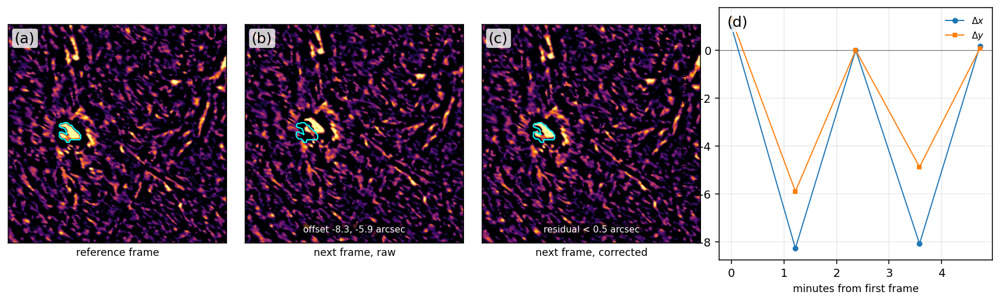

# pyprepchase

Preprocessing for [CHASE](http://chase.bao.ac.cn/) / HIS Level-1 data: per-frame pointing model,
sub-pixel registration, and line-core extraction, with provenance and quality flags.

The package exists because of one concrete problem: a CHASE `_HA.fits` cube is delivered in
detector coordinates, and the solar disk moves by several pixels from frame to frame. On
2025-06-10 the per-frame offset has a median of 5.3", a 95th percentile of 10.1" and a maximum
of 13.6", while the frame cadence is 72 s. Any analysis with a fixed pixel window (crop, template
tracking, contour extraction, optical flow) sees that offset as target motion: the classic
"sawtooth" of about 8" between consecutive frames.

The offset is recorded in the header: `CRPIX1`/`CRPIX2` move with the image. `pyprepchase` turns
those cards into an explicit, testable model, resamples every frame onto a common grid, and writes
the model, the audit and the flags next to the products.

## See it work



Five real CHASE frames from 2025-06-10, the excerpt shipped in
[`examples/data`](examples/data) (512 x 512 pixels, three channels, 8 MB). (a) the reference frame,
(b) the next frame with the reference contour overlaid: the whole field is displaced by 8.3 arcsec in
x and 5.9 arcsec in y, (c) the same frame after the `CRPIX` correction, (d) the per-frame shift. The
odd/even stack difference drops from 25.4 to 5.1 DN.

```bash
python examples/demo.py          # rebuilds docs/demo.png from the bundled data
```

## Install

```bash
pip install -e .            # core: numpy, scipy, astropy
pip install -e ".[plot]"    # + matplotlib for the QC figure
```

Python 3.9+.

## Command line

```bash
# what is in this day?
pyprep-chase index --root /data2/Chase/Lev1 --date 2025-06-10

# per-frame pointing model (header only, seconds)
pyprep-chase model --root /data2/Chase/Lev1 --date 2025-06-10 --out ~/chase/prep

# audit CRPIX against the solar limb on a sample of frames (reads pixels)
pyprep-chase audit --root /data2/Chase/Lev1 --date 2025-06-10 --n 10

# full pipeline: model + audit + flags + products + manifest + QC figure
pyprep-chase run --root /data2/Chase/Lev1 --date 2025-06-10 \
    --outdir ~/chase/prep --channels 68,69,70,71,72 --start 0 --count 25

# same, but derive the line core from CRVAL3/CDELT3 and average +/- 2 channels
pyprep-chase run --root /data2/Chase/Lev1 --date 2025-06-10 \
    --outdir ~/chase/prep --line-core --half-width 2
```

## Python API

```python
from pyprepchase import PrepConfig, PrepPipeline, JitterModel, discover

frames = discover("/data2/Chase/Lev1", "2025-06-10")
model = JitterModel.build(frames, reference="median")
print(model.stats())

cfg = PrepConfig(root="/data2/Chase/Lev1", date="2025-06-10", outdir="~/chase/prep")
cfg.output.outdir = "~/chase/prep"
cfg.channels = (70,)
manifest = PrepPipeline(cfg).run_day(do_audit=False)
print(manifest["stats"])
```

The model is JSON-serialisable and stable across runs:

```python
model.save("jitcal_20250610.json")
again = JitterModel.load("jitcal_20250610.json")
```

## What it does, and what it does not

| Step | Does | Does not |
|---|---|---|
| `model` | reads `CRPIX1/CRPIX2`, builds `(dx, dy)` per frame to a median reference | trust the header blindly: `audit` checks it |
| `audit` | fits the solar limb circle and compares `limb - CRPIX` | model the scan pattern or the instrument PSF |
| `apply` | spline resampling (cubic by default), optional crop, updated WCS | resample the wavelength axis |
| `run` | the above plus `manifest.json` (with per-step timing), per-frame flags and a QC figure | remove cosmic rays, flats or dark current |
| flags | `gap_before`, `repoint`, `limb_mismatch`, `first`/`last` | decide which frames your science needs |

Accuracy measured on CHASE data: `limb - CRPIX` is constant to 0.10 to 0.21 pixel over a day, and
the tracking residual of a 25-frame segment drops from 8.6" to 0.38". See
[`docs/method.md`](docs/method.md) for the numbers and the diagnostics.

## Iron rules for CHASE data

1. CHASE data are either opened read-only, or copied under the user's `chase/` directory first.
2. Programs and written files stay under the user's home directory.

`pyprepchase` opens every input with `mode="readonly"` and writes only to `outdir`.

## Using it from `solar-chromosphere-velocity`

`scv` can enable this preprocessing optionally (see [`docs/scv.md`](docs/scv.md)):

```python
from pyprepchase.scv import prepare
info = prepare("/data/.../RSM20250610T010407_0000_HA.fits",
               cache_dir="~/chase/prep_cache")
```

The corrected cube is cached and can be fed to `scv` like any other FITS file.

## Tests

```bash
pytest
```

The suite builds synthetic CHASE cubes (no real data needed) and covers the model, the limb audit,
the resampling, the flags, the pipeline, the CLI and the scv adapter.

## License

MIT. See [LICENSE](LICENSE).
